# Grafo de Dependencias del Proyecto

Este documento presenta el diagrama de dependencias entre módulos y requerimientos funcionales (RF) para el flujo de procesamiento de video, detección, captura, filtrado y generación de reportes.

---

## Diagrama de Flujo y Dependencias

```mermaid
---
config:
  layout: elk
  themeVariables:
    textColor: '#111827'
    nodeTextColor: '#111827'
    titleColor: '#111827'
    edgeLabelBackground: '#565656'
---
flowchart TD
    %% Estilos visuales para los subgrafos por responsable (letras oscuras de alto contraste)
    classDef default color:#111827
    classDef nicolas fill:#eef2ff,stroke:#818cf8,stroke-width:2px,color:#111827
    classDef diego fill:#fff7ed,stroke:#fb923c,stroke-width:2px,color:#111827
    classDef walter fill:#f0fdf4,stroke:#4ade80,stroke-width:2px,color:#111827
    classDef daniela fill:#fdf4ff,stroke:#e879f9,stroke-width:2px,color:#111827
    classDef contract fill:#ecfeff,stroke:#22d3ee,stroke-width:2px,stroke-dasharray: 5 5,color:#111827
    classDef userNode fill:#f0f9ff,stroke:#38bdf8,stroke-width:2px,color:#111827

    subgraph ModNicolas["Módulo de Nicolás: Procesamiento e Histogramas"]
        RF01["<b>RF01</b><br/>Cargar y abrir video"]
        RF02["<b>RF02</b><br/>Leer y comprender frames"]
        RF03["<b>RF03</b><br/>Definir las tres ROI"]
        RF04["<b>RF04</b><br/>Representar visualmente ROI"]
        RF05["<b>RF05</b><br/>Detectar cambios de estado"]
        RF01 --> RF02
        RF02 --> RF03
        RF03 --> RF04
        RF04 --> RF05
    end

    subgraph ModDiego["Módulo de Diego: Comandos y Ventana Temporal"]
        RF06["<b>RF06</b><br/>Identificación de comando"]
        RF07["<b>RF07</b><br/>Validación de la acción"]
        RF08["<b>RF08</b><br/>Ventana temporal posterior"]
        RF09["<b>RF09</b><br/>Captura posterior - Candidatos"]
        RF06 --> RF07
        RF07 --> RF08
        RF08 --> RF09
    end

    subgraph ModWalter["Módulo de Walter: Calidad y Selección"]
        RF10["<b>RF10</b><br/>Evaluación de calidad"]
        RF11["<b>RF11</b><br/>Selección del mejor frame"]
        RF12["<b>RF12</b><br/>Guardar captura original"]
        RF15["<b>RF15</b><br/>Procesamiento opcional - CLAHE"]
        RF10 --> RF11
        RF11 --> RF12
        RF11 --> RF15
    end

    subgraph ModDaniela["Módulo de Daniela: Organización y Reporte PDF"]
        RF13["<b>RF13</b><br/>Clasificación de captura"]
        RF14["<b>RF14</b><br/>Organización por temas"]
        RF16["<b>RF16</b><br/>Generación de reporte PDF"]
        RF13 --> RF14
        RF14 --> RF16
    end

    Usuario(["<b>Usuario</b><br/>Descarga PDF"])

    %% Conexiones de frontera entre módulos
    RF05 -->|"Contrato: Estado ROI<br/>LIBRE / CUBIERTA"| RF06
    RF09 -->|"Contrato: Colección<br/>frames_candidatos"| RF10
    RF12 -->|"Ruta captura original"| RF13
    RF15 -->|"Ruta captura procesada"| RF13
    RF16 -->|"Entrega final"| Usuario

    %% Aplicar estilos
    class ModNicolas nicolas
    class RF01,RF02,RF03,RF04,RF05 nicolas
    class ModDiego diego
    class RF06,RF07,RF08,RF09 diego
    class ModWalter walter
    class RF10,RF11,RF12,RF15 walter
    class ModDaniela daniela
    class RF13,RF14,RF16 daniela
    class Usuario userNode
```

---

## Detalle de Módulos y Responsables

| Módulo | Responsable | Descripción de Responsabilidad | Requerimientos |
|---|---|---|---|
| **Procesamiento e Histogramas** | Nicolás | Apertura y lectura del video, segmentación visual y monitoreo de regiones de interés (ROI). | RF01, RF02, RF03, RF04, RF05 |
| **Comandos y Ventana Temporal** | Diego | Detección y validación de comandos según el estado de las ROI y extracción de frames candidatos. | RF06, RF07, RF08, RF09 |
| **Calidad y Selección** | Walter | Evaluación de nitidez/calidad métrica, selección del frame óptimo y post-procesamiento (CLAHE). | RF10, RF11, RF12, RF15 |
| **Organización y Reporte PDF** | Daniela | Clasificación temática de capturas y renderizado del documento final descargable. | RF13, RF14, RF16 |

---

## Contratos de Interfaz entre Módulos

1. **Nicolás $\rightarrow$ Diego (`RF05` $\rightarrow$ `RF06`)**:
   - **Contrato:** `Estado ROI (LIBRE / CUBIERTA)`.
   - **Propósito:** Notifica el cambio de estado detectado en las regiones de interés para desencadenar la identificación de comandos.

2. **Diego $\rightarrow$ Walter (`RF09` $\rightarrow$ `RF10`)**:
   - **Contrato:** `Colección frames_candidatos`.
   - **Propósito:** Pasa el lote temporal de fotogramas capturados para su análisis y descarte.

3. **Walter $\rightarrow$ Daniela (`RF12` / `RF15` $\rightarrow$ `RF13`)**:
   - **Contrato:** `Ruta captura original` y `Ruta captura procesada`.
   - **Propósito:** Proporciona los archivos de imagen finales listos para ser catalogados y estructurados.

4. **Daniela $\rightarrow$ Usuario (`RF16` $\rightarrow$ `Usuario`)**:
   - **Entrega final:** Documento PDF consolidado para descarga.
