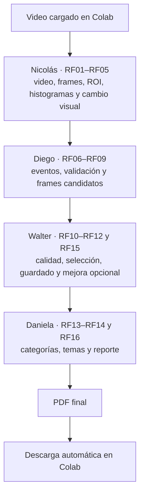

# Pizarra Snap

Sistema de visión por computadora que permite registrar contenido de una pizarra mediante tres comandos visuales. El docente activa cada comando cubriendo brevemente una zona de la pizarra; el sistema detecta la acción, elige una captura de buena calidad y genera un reporte PDF organizado por temas.

Proyecto colaborativo desarrollado para la **Diplomatura en Inteligencia Artificial**.

## Estado actual

Los requerimientos RF01–RF16 están implementados y conectados de punta a punta en `main`.

- Rama canónica: `main`
- Versión consolidada: `5900fa5a7d982e408259760617fde1f613426f79`
- Notebook oficial: [`notebooks/PizarraSnap.ipynb`](notebooks/PizarraSnap.ipynb)
- Entorno soportado actualmente: Google Colab

La versión consolidada se incorporó a `main` mediante fast-forward, sin reescribir la historia de los aportes. El notebook actual fue descargado desde `main`, ejecutado con **Run All** en Google Colab y validado manualmente de principio a fin con el video oficial.

### Resultado de la corrida de validación con el video oficial

| Resultado | Valor observado |
|---|---:|
| Eventos detectados | 3 |
| Orden | `CAPTURA_NORMAL` → `CONCEPTO_IMPORTANTE` → `FIN_DE_TEMA` |
| Frames candidatos por evento | 57 |
| Capturas seleccionadas | 3 |
| Temas generados | 1 tema cerrado |
| Páginas del PDF | 3 |
| Descarga del PDF | Automática en Google Colab |

Estos valores describen **la corrida oficial validada**. No son constantes del algoritmo: pueden cambiar con otro video, FPS, duración, cantidad de eventos o contenido de la clase.

El PDF conservó el diseño visual original de Daniela. La portada validada utiliza:

```text
INSTITUCIÓN: UTN
MATERIA: DIPLOMATURA EN IA
```

## Qué problema resuelve

Pizarra Snap permite que un docente solicite capturas sin usar teclado, mouse, botones electrónicos ni comandos de voz. La interacción se realiza mediante tres zonas visuales:

- **Captura normal:** registra contenido general.
- **Concepto importante:** marca una captura con tratamiento destacado en el reporte.
- **Fin de tema:** incluye la captura actual y cierra el tema en el PDF.

Cuando una zona vuelve a quedar libre, el sistema conserva una ventana breve de frames posteriores. Esto evita elegir inmediatamente una imagen que todavía pueda mostrar la mano o el borrador en movimiento.

## Cómo funciona



### Pipeline técnico

```text
VIDEO
  ↓
FRAMES BGR
  ↓
REGIONES DE INTERÉS (ROI)
  ↓
HISTOGRAMAS NORMALIZADOS
  ↓
ESTADO LIBRE / CUBIERTA
  ↓
EVENTO VALIDADO
  ↓
VENTANA TEMPORAL POSTERIOR
  ↓
FRAMES CANDIDATOS
  ↓
EVALUACIÓN DE CALIDAD
  ↓
MEJOR FRAME + PNG
  ↓
PROCESAMIENTO CLAHE OPCIONAL
  ↓
CLASIFICACIÓN Y TEMAS
  ↓
PDF
```

Un **frame candidato** es una imagen del video almacenada durante la ventana posterior al evento. Se conservan varias opciones para que el módulo de Walter pueda seleccionar posteriormente la de mejor calidad.

Los contratos detallados entre etapas están documentados en [`PLAN_TRABAJO_PIZARRA_SNAP.md`](PLAN_TRABAJO_PIZARRA_SNAP.md).

## Responsabilidades del equipo

| Integrante | Requerimientos | Responsabilidad funcional | Estado |
|---|---|---|---|
| Nicolás | RF01–RF05 | Video, frames, ROI, histogramas y detección de cambios | Validado; RF05 conserva una limitación conocida |
| Diego | RF06–RF09 | Eventos, validación, ventana temporal y frames candidatos | Validado; RF09 conserva una limitación de memoria |
| Walter | RF10–RF12 y RF15 | Calidad, selección, guardado y procesamiento opcional | Validado |
| Daniela | RF13–RF14 y RF16 | Clasificación, temas y generación del PDF | Validado |

El **diseño visual original del PDF es de Daniela**. La integración preservó su portada, paleta, logo, wordmark, fondos, tarjetas, jerarquía visual y renglones para notas, adaptándolos al contrato consolidado del pipeline.

La responsabilidad funcional no debe confundirse con la autoría Git de los commits de recuperación. La historia completa se explica en el plan de trabajo.

## Ejecutar en Google Colab

El notebook canónico está diseñado actualmente para Google Colab.

1. Desde la rama `main`, abrir o descargar [`notebooks/PizarraSnap.ipynb`](notebooks/PizarraSnap.ipynb).
2. Descargar el video oficial [`proyecto_pizzarasnap.mp4`](https://drive.google.com/file/d/1Vcixn88RZXEH3cLLovZQJBfYXKoIKlMb/view?usp=drive_link).
3. Abrir el notebook en Google Colab.
4. Seleccionar **Runtime → Run All**.
5. Cuando aparezca el selector, elegir exactamente `proyecto_pizzarasnap.mp4`.
6. Esperar a que finalicen RF01–RF16.
7. La última celda iniciará la descarga del PDF cuando `pdf_path_real` exista.

No se garantiza un tiempo exacto de ejecución. La duración depende del entorno de Colab, el video y los recursos disponibles.

El manual operativo, las rutas temporales y la resolución de problemas se encuentran en [`notebooks/README.md`](notebooks/README.md).

## Entradas y salidas

### Entrada

```text
proyecto_pizzarasnap.mp4
```

El video no se almacena en Git porque es un archivo de prueba pesado. El enlace de Google Drive debe conservar permisos de acceso adecuados para el equipo.

### Salidas intermedias

- `capturas`: eventos confirmados con sus frames candidatos.
- `resultados_walter`: ganador, métricas y rutas persistidas por evento.
- `resultados_reporte`: registros livianos para clasificación y reporte.
- `temas`: capturas agrupadas en orden y con estado de cierre.
- Capturas PNG originales y, cuando aporta valor, versiones procesadas.

### Salida final

```text
reporte_pizarra_snap_real.pdf
```

El PDF se genera en almacenamiento temporal y se descarga al finalizar la ejecución en Colab. Su número de páginas depende de los temas y capturas de cada ejecución.

## Tecnologías utilizadas

| Tecnología | Uso actual |
|---|---|
| Python 3 | Lenguaje y runtime del notebook |
| Google Colab | Carga del video, ejecución y descarga del PDF |
| OpenCV | Video, frames, ROI, histogramas, calidad y guardado de imágenes |
| NumPy | Representación y manipulación de frames |
| Matplotlib | Visualización didáctica de imágenes e histogramas |
| ReportLab | Maquetación y generación del PDF |
| Pillow | Fondos, imágenes y composición visual del reporte |
| pypdf | Validación del PDF generado |

OpenCV, NumPy y Matplotlib son provistos normalmente por Google Colab. El notebook instala ReportLab, Pillow y pypdf antes de generar y validar el reporte. Actualmente no se fijan versiones; hacerlo queda como mejora futura de reproducibilidad.

### Técnicas evaluadas pero no adoptadas

No forman parte del pipeline consolidado:

- threshold adicional;
- Canny;
- operaciones morfológicas;
- corrección de perspectiva.

Estas técnicas se evaluaron, pero no demostraron aportar valor a las capturas del alcance actual y no existe una geometría validada que justifique recorte o perspectiva. La decisión evita agregar transformaciones sin evidencia de mejora.

## Limitaciones conocidas

Estas limitaciones no son errores del flujo validado:

- **RF03 — ROI fijas:** las coordenadas están ajustadas a la cámara y resolución del video actual.
- **RF05 — umbral experimental:** `0.40` depende de iluminación, cámara, pizarra y posición de las ROI.
- **Inicio — referencia libre:** el pipeline asume que las tres ROI están libres alrededor del segundo `0.5`.
- **RF09 — memoria:** conserva frames completos durante las ventanas de captura; el consumo aumenta con resolución, FPS y eventos.
- **RF10 — score heurístico:** combina 55% nitidez, 30% estabilidad y 15% contraste dentro de cada evento.
- **RF13 — fallback de imagen:** funciona para las rutas generadas por el pipeline y conserva margen de robustez futura ante archivos corruptos.
- **Entorno:** el notebook canónico depende actualmente de `google.colab`.
- **Dependencias:** las versiones no están fijadas.
- **Tamaño del notebook:** los outputs persistidos hacen que el archivo pese aproximadamente 10,7 MB.

La clasificación completa entre limitación, deuda técnica, decisión de diseño y mejora futura se mantiene en el plan de trabajo.

## Trabajo colaborativo e integración

El proyecto conserva aportes funcionales reales de los cuatro integrantes. Cuando un módulo necesitó adaptación, se siguió este criterio:

```text
APORTE ORIGINAL
  ↓
DESAFÍO DE INTEGRACIÓN
  ↓
ADAPTACIÓN NECESARIA
  ↓
SOLUCIÓN CONSOLIDADA
```

Las ramas originales y de recuperación siguen preservadas como evidencia. Los cambios consolidados llegaron a `main` mediante una historia controlada y un fast-forward final.

## Estructura del repositorio

```text
pizarra-snap/
├── .gitignore
├── README.md
├── PLAN_TRABAJO_PIZARRA_SNAP.md
└── notebooks/
    ├── README.md
    └── PizarraSnap.ipynb
```

## Documentación

- [Plan técnico, RF, contratos, decisiones e historia](PLAN_TRABAJO_PIZARRA_SNAP.md)
- [Manual operativo del notebook](notebooks/README.md)
- [Notebook canónico](notebooks/PizarraSnap.ipynb)
